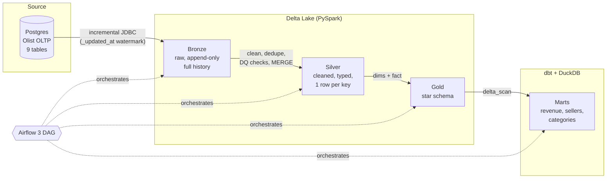
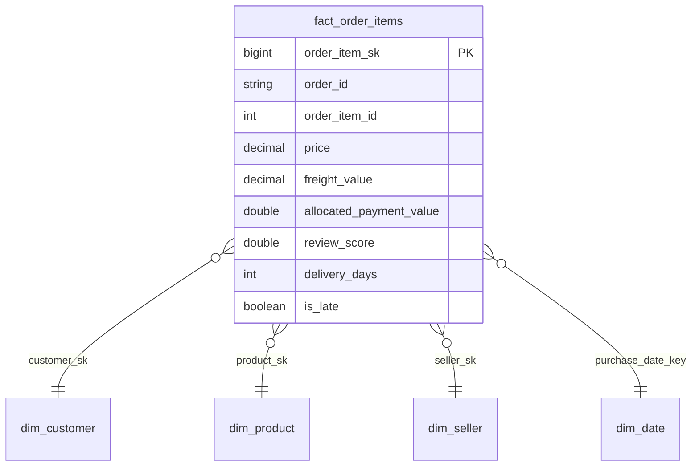

# E-commerce Sales Lakehouse

An end-to-end batch data pipeline on the public **Olist Brazilian e-commerce dataset**
(~100K orders, 9 related tables). Data moves from an operational Postgres database through
a **Medallion lakehouse** (Bronze → Silver → Gold) on **Delta Lake**, built with **PySpark**,
orchestrated by **Apache Airflow 3**, and modelled into analytics marts with **dbt**.


## Architecture



| Layer | What it holds | How it's written |
|---|---|---|
| **Bronze** | Every version of every source row, plus `_ingested_at`, `_batch_id` | Append, partitioned by ingest date |
| **Silver** | One clean, typed, current row per business key | `MERGE` (upsert) after data-quality checks |
| **Gold** | Star schema: `fact_order_items` + 4 dimensions | Rebuilt from silver, fact Z-ordered by date |
| **Marts** | Business tables: monthly revenue, seller performance, category sales | dbt models + tests in DuckDB |

## Data model (gold)



**Grain:** one row per item sold. An order's payment is stored once per order in the source,
so it is spread across the order's items in proportion to item value (`allocated_payment_value`),
which makes revenue by product or seller add up correctly.

## Key engineering decisions

- **Incremental loads.** The source tables carry an `_updated_at` column kept current by a
  Postgres trigger. Bronze pulls only rows changed since the last saved watermark; silver
  processes only bronze rows that arrived since its own watermark.
- **Idempotent and retry-safe.** Watermarks are saved only after a successful write, and silver
  uses Delta `MERGE`, so re-running a failed task never duplicates data.
- **Data quality gates.** Silver checks keys (not null, unique), value ranges and allowed values
  before writing. Error-level failures stop the pipeline; every result is stored in
  `_meta/dq_results`. dbt adds referential-integrity tests on gold and a revenue reconciliation
  test between the marts and the fact table.
- **Schema evolution.** Bronze appends with `mergeSchema`, so a new source column is added
  instead of breaking the load.
- **Surrogate keys.** Dimensions use a deterministic hash of the natural key (`xxhash64`), so
  facts and dimensions can be rebuilt independently and still join.

## Tech stack

PySpark 3.5 · Delta Lake 3.2 · Apache Airflow 3 · dbt-duckdb · PostgreSQL 16 · Docker Compose ·
pytest · GitHub Actions · ruff

## Run it locally

You need **Docker Desktop** (give it at least 4 GB of memory) and about 2 GB of disk.

1. **Get the data.** Download the dataset from
   [Kaggle: Brazilian E-Commerce Public Dataset by Olist](https://www.kaggle.com/datasets/olistbr/brazilian-ecommerce),
   unzip it, and put the 9 CSV files in `data/raw/`.

2. **Start the stack.** The first start builds the image and loads the CSVs into Postgres
   (a few minutes):

   ```bash
   docker compose up -d --build
   ```

3. **Run the pipeline.** Open http://localhost:8080, turn on the `olist_lakehouse` DAG and click
   ▶ (trigger). Or from the terminal:

   ```bash
   docker compose exec airflow airflow dags trigger olist_lakehouse
   ```

4. **See incremental loading work.** Change some rows in the source, run the DAG again, and
   watch bronze pick up only those rows:

   ```bash
   docker compose exec postgres psql -U postgres -d olist -f /scripts/simulate_changes.sql
   docker compose exec airflow airflow dags trigger olist_lakehouse
   ```

5. **Query the results.**

   ```bash
   docker compose exec airflow /home/airflow/dbt-venv/bin/python -c "import duckdb; print(duckdb.connect('/opt/lakehouse/warehouse/olist.duckdb').sql('select * from mart_monthly_revenue order by month_start desc limit 12'))"
   ```

The lakehouse files are in `data/lakehouse/` on your machine, so you can see the Delta logs
(`_delta_log/`) and partitions directly.

### Run the tests

```bash
pip install -r requirements-dev.txt   # needs Java 17
pytest
```

## Project structure

```
├── dags/olist_lakehouse.py        Airflow DAG
├── lakehouse/
│   ├── config.py                  paths, source tables and their keys
│   ├── spark.py                   SparkSession with Delta + JDBC
│   ├── watermark.py               incremental-load state
│   ├── quality.py                 data-quality checks
│   ├── delta_utils.py             MERGE / overwrite helpers
│   ├── transforms/silver.py       cleaning functions (pure, unit-tested)
│   ├── transforms/gold.py         star-schema builders (pure, unit-tested)
│   └── jobs/                      bronze.py, silver.py, gold.py entry points
├── dbt/olist/                     sources, staging, marts, tests
├── docker/postgres-init/          source DB schema + CSV load + change tracking
├── scripts/simulate_changes.sql   creates changes for incremental runs
├── tests/                         pytest unit tests (run in CI)
└── docs/LEARNING.md               concepts behind each design choice
```

## What I'd add next

- Partition the fact table by month and `MERGE` it incrementally instead of rebuilding.
- Move from local Spark to a cluster (Databricks or EMR) and from local files to S3.
- Publish dbt docs and data-quality results to a small dashboard.

## Dataset

[Olist Brazilian E-Commerce Public Dataset](https://www.kaggle.com/datasets/olistbr/brazilian-ecommerce),
licensed CC BY-NC-SA 4.0. The data is not stored in this repository.
